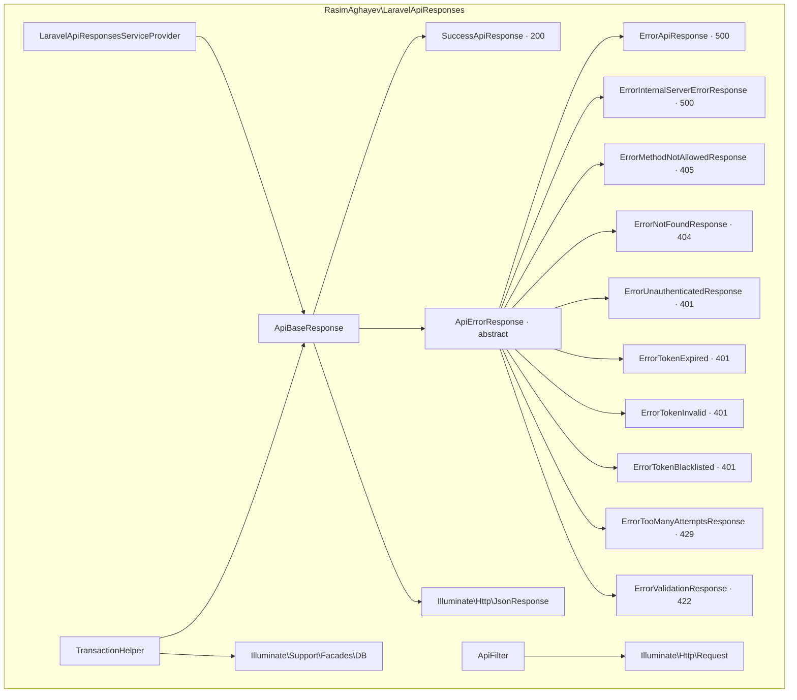

# ARCHITECTURE.md — laravel-api-responses

## Purpose
Shared Laravel package providing standardized API response classes, extracted from Group B repos (atl_tech, AC-Task, blockchain-monitoring-api). Delivers a consistent JSON response envelope, status-specific error responses, a database transaction wrapper, and a request-filter builder. Published via GitHub Packages (ghcr.io), not Packagist. MIT license. Library (not an application).

## Module diagram


## JSON API contract (response envelope)
Every response renders as:
```json
{
  "timestamp": "2026-11-10T14:29:09+00:00",
  "path": "/api/resource",
  "method": "GET",
  "error": null,
  "result": { ... }
}
```
On 422 validation failures: `error` holds the validation messages array and `result` is `[]`. Other errors: `error` holds the default or supplied message and `result` is `[]`.

## Data models
The package owns no Eloquent models and no database schema. Response classes are stateless value/DTO objects. `TransactionHelper` wraps `DB::beginTransaction()` / `commit()` / `rollBack()` around a callback and maps exceptions to typed error responses.

## Authentication
No authentication of its own. The token-related error classes (`ErrorTokenExpired`, `ErrorTokenInvalid`, `ErrorTokenBlacklisted`, `ErrorUnauthenticatedResponse`) are DTOs consumed by host applications that manage auth (Sanctum/Passport) themselves. No guards, providers, or password logic live in this package.

## Database
`TransactionHelper` is the only DB touchpoint; it relies on the host application's configured `default` connection. No migrations, factories, or seeders are shipped.

## Configuration
`LaravelApiResponsesServiceProvider` has empty `register()`/`boot()` and is auto-discovered via `extra.laravel.providers` in `composer.json`. No config file is published; no env vars are read by the package.

## Testing
PHPUnit 13 (`^13.0`). One test file: `tests/ResponseTest.php` (4 tests, 6 assertions). phpunit 13 requires PHP >= 8.4.1; suite verified green via Docker (`php:8.4-cli`, exit 0). No `phpunit.xml` is committed.

## Security
- No secrets, tokens, or keys committed; full-history scan clean.
- Response classes never log or return credentials.
- CORS and rate limiting are host-application concerns, not package concerns.
- Dependency pinning is the main supply-chain risk (see `REPOSITORY_AUDIT.md` / `TECHNICAL_DEBT.md`).
